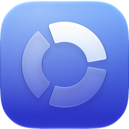
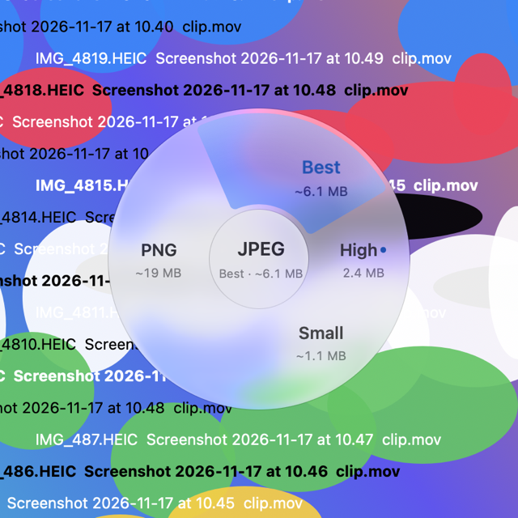
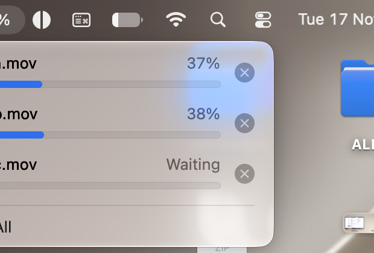
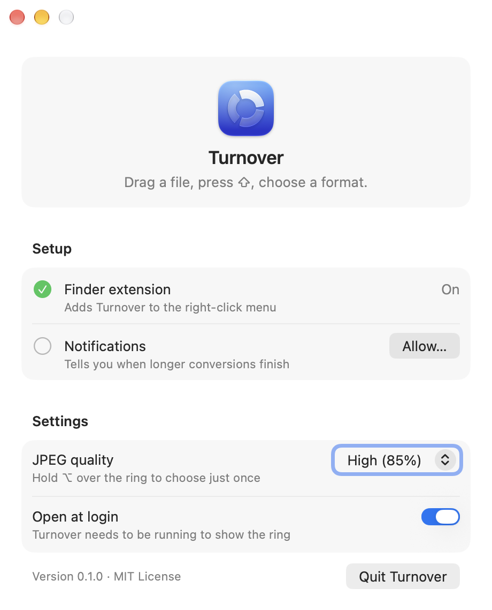

<p align="center">
  
</p>

<h1 align="center">Turnover</h1>

<p align="center">
  <strong>Turn the <code>.heic</code> photos and <code>.mov</code> videos from your iPhone and Mac into PNG, JPEG and MP4, right from Finder. Make an MP4 smaller. Drag an image out of a web page to save it in the format you want.</strong>
</p>

<p align="center">
  <a href="https://github.com/guivalenca/turnover/actions/workflows/ci.yml"></a>
  
  
  <a href="LICENSE"></a>
</p>

<p align="center">
  <a href="#using-turnover">Using Turnover</a> ·
  <a href="#install">Install</a> ·
  <a href="#troubleshooting">Troubleshooting</a> ·
  <a href="#command-line">Command line</a> ·
  <a href="docs/architecture.md">How it works</a> ·
  <a href="CONTRIBUTING.md">Contributing</a>
</p>


## Using Turnover

### Right-click

Select photos or videos in Finder, right-click, and choose **Turnover ›** PNG, JPEG, MP4 or Smaller MP4. The menu only offers the formats that fit what you selected, such as `PNG (3 images)` or `Smaller MP4 (1 video)`.

### Drag and press ⇧

Start dragging files, from Finder, the Desktop or a Dock stack, and press **⇧**. A ring of formats opens under the pointer, showing how big each new file will be. Drop on a format. The files you dragged stay where they are.

<p align="center">
  <picture>
    <source media="(prefers-color-scheme: dark)" srcset="docs/images/ring-dark.png">
    
  </picture>
</p>

- Hold **⌥** over the ring to choose the JPEG quality for this drop only: Best, High or Small.
- Dragging photos and videos together? **Rest** on a format for a moment to add it (it fills and shows ✓), then drop on another. Drop straight on one format to convert only that kind of file.
- To cancel, drop anywhere off the ring or press Esc. Release ⇧ to carry on with a normal drag.

### Make an MP4 smaller

Start dragging an MP4, or several, and press **⇧**. The ring offers three qualities, each with about how big the new file will be. Drop on one:

| Quality | Frame size | Keeps at most |
| --- | --- | --- |
| **High** | Up to 1080p | 60% of the video's bit rate |
| **Medium**, the default | Up to 720p | 35% |
| **Small** | Up to 480p | 18% |

- The new file appears next to the original as `clip-s.mp4`, and the original stays.
- With photos or other videos in the same drag, it is one entry, **Smaller**, at Medium. Hold **⌥** to choose the quality.
- Right-click › Turnover › **Smaller MP4** uses Medium.
- To shrink a MOV or M4V, convert it to MP4 first.

### Drag an image out of a web page

Start dragging an image in Safari, Chrome or Dia and press **⇧**. The same ring opens, and its centre says what the image is, such as `WebP · 1600 × 1067`. Drop on **PNG** or **JPEG** to save it in that format, or on **Original** to save it as it is.

Where you drop the ring decides where the image is saved:

| Dropped over | Saved |
| --- | --- |
| The Desktop | On the Desktop, where you dropped it. |
| A Finder window | In the folder that window shows, selected. |
| Another app, such as a chat or a mail message | In Downloads, and copied: press **⌘V** to attach it there. |
| Anything else, the browser included | In Downloads. A short note by the pointer says so. |

The file is named after the image's address when that names a file (`mountain-lake.png`), otherwise after its title, otherwise `image`.

- In a search's grid of results, what you drag is the search engine's small thumbnail. Click a result first and drag the larger preview to get the real image.
- Animated GIFs and WebPs keep their animation only as Original; PNG and JPEG save the first frame. SVGs aren't converted.
- Other Chromium browsers should behave like Chrome. Firefox hasn't been tested yet.

### Where the new file goes

The new file appears next to the original, with the same name and the new extension (a smaller MP4 gets `-s` after its name instead, like `clip-s.mp4`). Turnover never changes or overwrites a file.

- Converted from a Finder window, the new file is selected in it.
- Dropped on the ring on the Desktop, the new file appears where you dropped it: on the nearest free grid spot with Snap to Grid on, exactly there without it. No Finder window opens.
- If the name is taken, the new file is numbered, like `IMG_0420 2.jpg`. So is a smaller MP4 of a file already named with `-s`: `clip-s 2.mp4`. If the folder is read-only, the new file goes to Downloads and Turnover tells you.

### What converts to what

| From | To |
| --- | --- |
| Videos: MOV, M4V | **MP4**: H.264 and AAC, which play everywhere. Instant when the video is already H.264 (a large one takes a few seconds, the time to copy it); otherwise it is re-encoded at the same size and frame rate, with HDR mapped to SDR. H.264 that not every player decodes (High 10, 4:2:2, 4:4:4) is re-encoded too. |
| Videos: MP4 | **Smaller MP4** at High, Medium (the default) or Small: the same video re-encoded as H.264, with HDR mapped to SDR. Never enlarged, at the same frame rate, with AAC sound copied as it is. If it wouldn't come out smaller, nothing is written and Turnover says so. |
| Images: HEIC, HEIF, AVIF, WebP, TIFF, PNG, JPEG and most others macOS opens | **PNG**, or **JPEG** at Best (100%), High (85%, the default) or Small (60%) |
| Images dragged out of a web page | The same, or **Original**: the image as the page has it |

Dates, EXIF, location and colour profile are kept, and the orientation is applied.

### Progress and notifications

Quick conversions just appear. A longer one shows its progress in the menu bar, where you can stop it, and a notification tells you when it's done. Failures always notify.

<p align="center">
  
</p>

## Install

Turnover isn't on the App Store, and there is no download yet: you build it on your Mac with Xcode, in one command. It takes a few minutes the first time.

### What you need

- A Mac with **macOS 15** or later.
- **Xcode 26** or later, free from the [Mac App Store](https://apps.apple.com/app/xcode/id497799835).
- An **Apple ID**, if you want macOS to remember your answers to its permission questions (step 2).

No paid Apple developer account is needed.

### 1. Get Xcode ready

Install Xcode from the App Store and open it once, so it can finish installing its components. If you have more than one Xcode, or the command-line tools alone, point the terminal at the app:

```sh
sudo xcode-select -s /Applications/Xcode.app
```

### 2. Add a free signing certificate (recommended)

macOS remembers what you allow an app by its signature. With a certificate, Turnover keeps the same identity from one build to the next, so each permission is asked **once**. Without one, Turnover is signed ad hoc, and macOS asks again after every install or upgrade.

1. In Xcode, open **Xcode › Settings › Accounts** and sign in with your Apple ID.
2. Select your account, click **Manage Certificates…**, then **+ › Apple Development**.

`make install` finds the certificate in your keychain by itself.

### 3. Build and install

```sh
git clone https://github.com/guivalenca/turnover.git
cd turnover
make install
```

This builds Turnover, signs it, copies it to `/Applications`, turns on its Finder extension and opens it. Its "Built build/Turnover.app" line says how it was signed: "signed with a certificate" means macOS will remember your answers.

### 4. Check the setup

Turnover runs in the background, with no Dock icon, and opens at login. The first time, its window opens:

<p align="center">
  <picture>
    <source media="(prefers-color-scheme: dark)" srcset="docs/images/window-dark.png">
    
  </picture>
</p>

- **Finder extension** should show a green ✓. If it doesn't, click Open Settings… and turn Turnover on.
- **Notifications:** click Allow… so Turnover can tell you when long conversions finish or fail.
- **JPEG quality** is what right-click › JPEG uses. **Open at login** keeps Turnover ready for the ring.

Open Turnover from Applications or Spotlight to see this window again, or to quit.

### Permissions macOS asks once

| Prompt | When | Why |
| --- | --- | --- |
| Login Item Added | First launch | Turnover opens at login. You can turn it off in its window. |
| Notifications | The first notice, or Allow… in the window | To tell you when long conversions finish or fail. |
| Access to the Desktop, Documents, Downloads, a removable or network volume | The first conversion there, or the first web image saved there | To read the original and write the new file next to it, and to save web images where you drop them. Allow it. |
| Control Finder | The first drop on the ring on the Desktop, or of a web image over a Finder window | Only to put the new file where you dropped it, and to ask which folder a window shows. If you say no, a file on the Desktop goes where Finder puts new files, and a web image dropped over a Finder window goes to Downloads. |

Turnover needs no Accessibility, Input Monitoring or Screen Recording access. You can change any answer later in System Settings › Privacy & Security.

### Upgrade

```sh
cd turnover
git pull
make install
```

With a certificate (step 2), nothing is asked again.

### Uninstall

```sh
make uninstall
```

This quits Turnover, turns off its Finder extension, deletes the app, and resets its permissions and settings. macOS keeps the extension's empty folder, `~/Library/Containers/com.guivalenca.turnover.finder`; you can delete it in Finder.

## Troubleshooting

**Turnover › is missing from the right-click menu.** Open Turnover's window and check Finder extension. If it has no ✓, click Open Settings… and turn Turnover on. If it does, relaunch Finder: ⌥-right-click its Dock icon › Relaunch.

**Pressing ⇧ during a drag doesn't open the ring.** Turnover has to be running: open it from Applications, and keep Open at login on. If ⇧ was already down when the drag started, release it and press it again. Files that aren't photos or videos show a short hint instead of the ring.

**A web image saved from a search is tiny.** You dragged the result's thumbnail. Click the result and drag the larger preview instead.

**A web image went to Downloads instead of the Finder window I dropped it on.** Turnover asks Finder which folder the window shows, which needs System Settings › Privacy & Security › Automation › Turnover › Finder. Windows that show no folder, such as Recents or a search, also send it to Downloads.

**"Verifying Turnover…" flashes and Turnover doesn't open.** After an install, macOS checks the new app on its first launch, and a key pressed while that window is up can cancel it. Open Turnover again from Applications.

**macOS asks for the same permissions after every install.** Turnover was signed ad hoc: check that `make install` prints "signed with a certificate", and if it doesn't, add one (step 2). Answers given to an ad hoc build aren't carried over: macOS asks once more after the first signed install, then remembers.

**Files in one folder don't convert.** You may have answered Don't Allow when macOS asked about that folder. Turn Turnover on in System Settings › Privacy & Security › Files & Folders.

**"Can't be made any smaller".** The MP4 is already compressed about as far as it goes, as a still screen recording can be, so nothing was written. Try Small.

**The new file went to Downloads.** The original's folder can't be written to (a disk image, a shared folder, or a read-only drive), so Turnover saved it in Downloads and posted a notification saying so.

**"xcodebuild requires Xcode".** Run `sudo xcode-select -s /Applications/Xcode.app`, then `make install` again.

**Something else?** [Open an issue](https://github.com/guivalenca/turnover/issues/new) with your macOS version, what you did and what happened. Turnover's log helps:

```sh
log show --last 10m --style compact --info --debug --predicate 'subsystem == "com.guivalenca.turnover"'
```

## Command line

The `turnover` command converts like the app does. Build it from the clone:

```sh
swift build -c release --product turnover
.build/release/turnover IMG_0420.HEIC --to png
```

Copy `.build/release/turnover` to a folder on your `PATH` to use it anywhere.

```text
turnover <files…> --to png|jpeg|mp4|smaller [--quality <quality>]
turnover offers [--exact] <files…>
```

- Each new file is saved next to its original, and its path is printed.
- The exit code is 1 if any file couldn't be converted, and 64 for a usage error.
- `--quality` is `best`, `high` (the default) or `small` for JPEG, and `high`, `medium` (the default) or `small` for a smaller MP4.
- `offers` lists the formats each file can become, with estimated sizes and times, and converts nothing. With `--exact`, it waits for the exact image sizes the ring ends up showing (measured by encoding a few photos in memory; the others are scaled from them).
- Ctrl-C stops the conversions and leaves nothing behind.

## How it works

Turnover is a Swift package and an Xcode project with no third-party code. The converting is done with ImageIO and AVFoundation. The Finder extension builds the right-click menu and hands your choice to the app; the app runs every conversion, the ring, the menu bar progress and the notifications. The ring watches the mouse and modifier keys, which needs no permission. An image dragged out of a web page is read from the drag itself when you press ⇧, with no browser extension and nothing downloaded.

[docs/architecture.md](docs/architecture.md) explains the parts and how a conversion flows through them. [CONTRIBUTING.md](CONTRIBUTING.md) covers building, testing and changing Turnover. What changed in each version is in [CHANGELOG.md](CHANGELOG.md).

## Licence

MIT. See [LICENSE](LICENSE).
