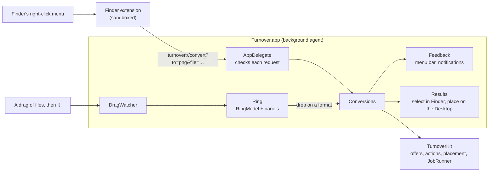

# How Turnover works

Turnover converts files in two ways, the Finder's right-click menu and the drag + ⇧ ring, and both end in the same place: one background app that runs every conversion. This page follows a conversion through the parts, then covers where the new files go, and the permissions all this needs.

The product decisions behind it are in the spec, [issue #1](https://github.com/guivalenca/turnover/issues/1), and the macOS risks were proven first in the spike, [issue #2](https://github.com/guivalenca/turnover/issues/2).

## The parts

| Target | Kind | Uses | What it is |
| --- | --- | --- | --- |
| `TurnoverKit` | Library | ImageIO, AVFoundation | Everything about files: what they are, what they can become and how big, converting them, and where the result goes. No UI. |
| `TurnoverAppCore` | Library | TurnoverKit | The app's rules that can be tested without AppKit: launch, settings, Open at login, feedback timing, notifications, and where new files go after a conversion. |
| `RingModel` | Library | TurnoverKit | The ring's behaviour as a state machine: events in, what to show and do out. |
| `TurnoverCLI` | Command | TurnoverKit | The `turnover` command. |
| `Turnover` | App | all three libraries | A background agent (`LSUIElement`, no Dock icon) that owns every conversion, the ring's windows, the menu bar item and the Turnover window. |
| `TurnoverFinder` | Finder Sync extension | TurnoverKit | The right-click menu. It never converts or writes a file. |

The libraries and the command are a Swift package (`Package.swift`); the app and the extension are an Xcode project generated from `project.yml`. There is no third-party code.

## From the right-click menu

1. Finder asks the extension for a menu. `FinderSync` reads the selection's **offers** from TurnoverKit and builds `Turnover ›` with one item per format that fits, such as `PNG (3 images)`. Finder may run several instances of the extension at once and calls it off the main thread, so it keeps no state.
2. Picking an item opens a URL, `turnover://convert?to=png&file=/path/a.heic&file=/path/b.heic`. The extension is sandboxed and can't write files, so the app, which registers the `turnover` scheme, does the work. LaunchServices launches it first if it isn't running.
3. Any process can open such a URL, so `AppDelegate` reads it with `ConversionRequest`, which accepts only `convert`, one known format and absolute paths to existing files. Even a forged request can only make new files next to existing ones.
4. `Conversions` starts a batch. JPEG from the menu uses the quality set in Turnover's window.

## From the ring

1. **Noticing the drag.** `DragWatcher` needs no Accessibility or Input Monitoring permission. Global *mouse* monitors need none, and they keep arriving during another app's drag. A drag of files is "the button is down and the drag pasteboard's change count moved"; while the button is down, the pressed buttons and ⇧ ⌥ are polled at 120 Hz. Key events never arrive without permission, so Esc is seen by the ring's own panel.
2. **Before ⇧.** The dragged files are read from the drag pasteboard as soon as the drag starts, and their offers start refining in the background (below), so the sizes are often exact by the time the ring opens.
3. **The ring.** `Ring` feeds what happens to a `RingModel` and acts on what it says. When the ring opens, transparent, non-activating panels cover every screen and become the drop destination everywhere: a drop anywhere off a format is refused and the drag slides back. The ring itself is drawn above them in its own window, in Liquid Glass on macOS 26 and later, or the system's translucent material on macOS 15.
4. **Choosing.** ⌥ fans JPEG out into Best, High and Small. Resting on a format for the system's spring-loading delay adds it, for selections of photos and videos together.
5. **Dropping** on a format starts a batch in `Conversions`, with where the drag came from (see [After the conversion](#after-the-conversion)).

## Converting (TurnoverKit)

- **Offers** say which formats fit each kind of file: PNG and JPEG for images, MP4 for videos, never a file's own format. Files nothing fits come with a reason, which the ring shows as a hint.
- **Estimates** come in two steps. A quick one, from sampling a few tiles at full resolution, arrives in under 50 ms. Then each image's exact size is measured by encoding it in memory, a few photos at a time with the rest scaled from them, and remembered in a cache keyed by the file's size and date. Measuring waits while conversions run.
- **Actions** convert one file. Images go through ImageIO, keep their EXIF, location, dates and colour profile, and have their orientation applied. For video, `MP4Plan` reads the tracks without decoding anything: H.264 that plays everywhere is copied into an MP4 as is; anything else, HEVC and HDR included, is re-encoded to 8-bit H.264 tagged BT.709, with AAC audio.
- **Placement** writes each output to a private temporary folder on the same volume, then moves it into place with an exclusive rename. A new file appears whole or not at all, never replaces another, and is numbered on a collision (`photo 2.png`). A read-only folder falls back to Downloads.
- **`JobRunner`** runs batches: images side by side, one per processor core, and at most two videos at a time, across every batch. Cancelling a job leaves nothing behind.

## After the conversion

What happens to the new files depends on where the conversion started (`ConversionOrigin`). A conversion that didn't start in a Finder window never opens one.

| Started from | What happens |
| --- | --- |
| A Finder window (menu or ring) | The new files are selected in it. |
| The ring, dropped on the Desktop | The new files are moved to where the ring was dropped. |
| The menu, on Desktop files | Nothing: Finder places them. |
| Anywhere else (a Dock stack, another app) | Nothing. |

**Where a drag started** (`DragSource`) is read when it starts, from `CGWindowListCopyWindowInfo`. That gives each window's owner, level and frame without any permission, since window names aren't read. A Finder window at the normal level under the pointer means a Finder window. The drag image and full-screen overlays, like the one the Dock puts up during a drag, are seen through. The Desktop can't be told by its window, which recent macOS doesn't always list, so a drag is the Desktop's when every dragged file sits directly in `~/Desktop`.

**Placing on the Desktop** (`FinderDesktop`, `DesktopLayout`). Only Finder can move a Desktop icon, so Turnover asks it over Apple Events, through `osascript` run as Turnover's child, with paths and points passed as arguments, never in the script's text. Finder doesn't snap an icon moved this way, so with Snap to Grid on, Turnover works the grid out itself. It reads every Desktop icon's position, finds the spacing and offset that put the most icons on grid lines, and puts each new file on the free grid spot nearest the drop. Reading and moving use the same coordinates, so the grid read is the grid moved onto. Without a grid, the file goes exactly where the ring was dropped; on a Desktop sorted by name or date, Finder places it.

## Feedback

`Feedback` decides what the app shows about each batch. The menu bar item appears only once a batch has run about a second, lists its jobs with a stop button each, and leaves 1.5 s after the last one ends. A batch that took over 3 s posts a notification whose Show in Finder selects the outputs. Every failure, and every output saved to Downloads instead, posts one too. Quick batches show nothing.

## Permissions and signing

| Permission | Why |
| --- | --- |
| Files & Folders (Desktop, Documents, Downloads, removable and network volumes) | Reading originals and writing next to them. |
| Automation › Finder | Placing new files on the Desktop. Optional: without it, Finder places them. |
| Notifications | Optional. |

Turnover needs no Accessibility, Input Monitoring or Screen Recording access: the ring uses global mouse monitors, and window names are never read.

macOS stores each answer against the app's code signature, by its designated requirement. Signed ad hoc, the requirement is the build's own hash, which changes with every build, so each install is a new app to macOS and it asks again. Signed with an Apple Development certificate, the requirement names the bundle ID and the certificate, which stay the same, so each permission is asked once. That is why `make install` uses a certificate when the keychain has one.

## Testing

- **TurnoverKit** is tested against real files: small committed photos and clips, converted for real and checked byte for byte where it matters.
- **RingModel** is a pure state machine, tested by feeding it events and times.
- **TurnoverAppCore** holds the decisions the app makes, such as feedback timing, drag sources and Desktop grid spots, so they are tested without AppKit.
- **TurnoverCLI** is tested end to end by running the built command.
- Finder, the ring's windows and the system prompts are checked by hand, with the checklist in the [pull request template](../.github/pull_request_template.md).
